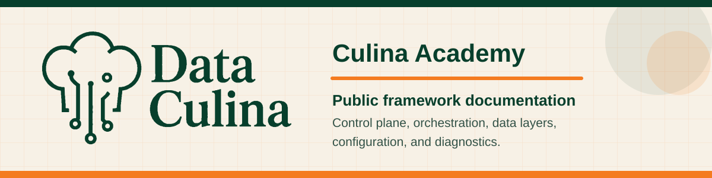

<p align="center">
  
</p>

# Culina Academy

Understand, configure, and operate the Data Culina framework. Start with an operating question, follow a configured job into its queue and execution evidence, then inspect the data or reporting boundary that matters.

Interested in working with Data Culina? Visit [dataculina.com](https://dataculina.com/).

## Use This Repo

| Your task | Start here | Continue with |
| --- | --- | --- |
| Understand what Culina does | [Start Here](docs/getting-started/README.md) | [Eight Video Tutorials](docs/tutorials/README.md) |
| Trace one workflow | [Quickstart](docs/getting-started/quickstart.md) | [Architecture](docs/architecture/README.md) |
| Configure ingestion, transformation, or service work | [Configuration Guide](docs/configuration/README.md) | [Current Examples](examples/current/README.md) |
| Understand your platform | [Platform Guide](docs/platforms/README.md) | [Version Compatibility](docs/reference/version-compatibility.md) |
| Monitor or diagnose a run | [Operations Guide](docs/operations/README.md) | [Diagnostic Queries](docs/troubleshooting/diagnostic-queries.md) |
| Understand history and reporting | [History And Reporting](docs/concepts/history-and-reporting.md) | [Data Layers](docs/architecture/data-layers.md) |
| Recover affected work | [Backfill And Recovery](docs/operations/backfill-and-recovery.md) | [Support Handoff](docs/troubleshooting/support-handoff.md) |

[Full documentation index](docs/README.md) · [Example catalog](examples/README.md) · [Field and schema references](docs/reference/README.md)

## Current Reference

The documentation is aligned with framework artifacts reviewed on **2026-10-08**, including the `0.2.34` execution contract. Check the [compatibility reference](docs/reference/version-compatibility.md) before applying guidance to an older deployment.

Current coverage includes portable storage and secret references, source-owned incremental boundaries, configured service jobs, managed fact append retries, SCD2 inferred members, CONS reporting publication, and control-plane monitoring. Platform qualification is described in the [platform guide](docs/platforms/README.md).

The eight videos explain the framework fundamentals. Use the written references for capabilities added after those recordings. Older sandbox examples remain useful for tracing complete relationships; the [example catalog](examples/README.md) explains which format each set demonstrates.

## Read And Download

Read the Markdown documentation in GitHub, or use **Code > Download ZIP** and extract the repository. Open [index.html](index.html) for the local directory. JSON examples are reference material; they require environment-specific configuration and review before deployment.

This repository supplies documentation and configuration examples. Engine installation and infrastructure provisioning are separate.

## Local Reading

Open `index.html` directly, or serve the extracted checkout:

```powershell
python -m http.server 8000
```

Open `http://localhost:8000`. The directory offers GitHub-rendered reading links and local source links.

## Project Files

[Support](SUPPORT.md) · [Security](SECURITY.md) · [Changelog](CHANGELOG.md) · [License](LICENSE)

## Validate A Checkout

```powershell
npm test
npm run validate:schemas
npm run validate:docs
npm run validate:examples
```
