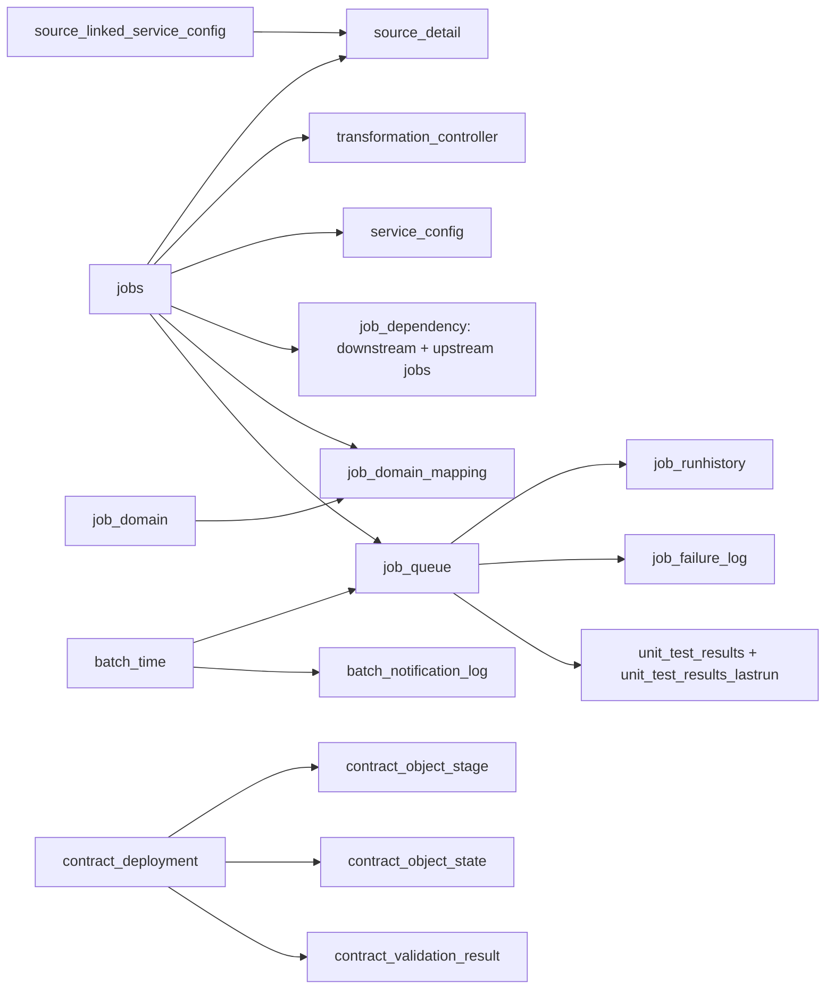

# Control Plane Schema

This catalog describes the current SQL control plane: 19 physical tables in `jobconfig`, three orchestration helper views, and reporting views in `rpt`. Names and fields below are SQL names, not the camelCase names in historical export files. See [Version Compatibility](../reference/version-compatibility.md) and [Platforms](../platforms/README.md).

Client/contract identity belongs to the metadata artifact and environment boundary; there is no physical `client` table or `client_id` column in this SQL project. Entity IDs are `UNIQUEIDENTIFIER` values, distinct from business keys, warehouse surrogate keys, and run identity.

## Entity Map



## Configuration Tables

| Table | Purpose | Key fields | Operating use |
| --- | --- | --- | --- |
| `jobs` | Work catalog. | `job_id`, `job_type`, `entity_name`, `frequency_group`, `max_retry_count`, `retry_delay_backoff`, `is_active`, audit fields. | Job types: Ingestion, Integration, Data Warehouse, Consumption, Service. |
| `source_linked_service_config` | Reusable source access profile. | `source_linked_service_config_id`, `source_name`, `source_type`, `source_linked_service_config`, audit fields. | JSON object with connection options and secret references. |
| `source_detail` | Job-specific read/load definition. | `source_detail_id`, `job_id`, `source_entity_name`, `source_select_query`, `source_delta_column`, `delta_or_full`, `fallback_watermark`, `source_linked_service_config_id`, file extensions, `staging_table_name`. | FULL/DELTA; DELTA requires a nonblank delta column. Linked-service FK is nullable. |
| `transformation_controller` | Transformation definition and quality flags. | `transformation_controller_id`, `job_id`, `transformation_type`, `transformation_name`, `parameters`, `test_data_integrity`, `test_duplicate_bks`, `test_null_bks`, `initial_load`, `is_active`. | JSON source/target/step contract; multiple controller rows are possible per job. |
| `service_config` | Service execution definition. | `service_config_id`, `job_id`, `service_type`, `service_config_value`, `isactive`, audit fields. | JSON object; at most one active row per job, enforced by a filtered unique index. |
| `job_dependency` | Direct readiness edges. | `job_dependency_id`, `job_id`, `dependent_job_id`, audit fields. | Downstream -> upstream; unique pair, no self-edge. |
| `job_domain` | Governance grouping and owner visibility. | `domain_id`, `domain_name`, `description`, `domain_owner_names`, timestamps. | Unique nonblank domain name; owner names are not delivery recipients. |
| `job_domain_mapping` | Job/domain bridge. | `mapping_id`, `job_id`, `domain_id`, `created_at`. | Many-to-many; unique job/domain pair. |

Configuration is maintained through approved changes, not by editing queue or diagnostic rows.

## Runtime Tables

| Table | Purpose | Typical fields | Operating use |
| --- | --- | --- | --- |
| `batch_time` | Batch lifecycle. | `batch_id`, `batch_start_time`, `batch_end_time`, `is_batch_completed`. | Completion is a lifecycle bit, not a success status. |
| `job_queue` | Current work state. | `queue_id`, `batch_id`, `job_id`, `status`, `current_retry_count`, `job_start_datetime`, `job_end_datetime`, `retry_datetime`, `queue_inserted_datetime`. | FKs to jobs/batches; nonnegative retry count. |
| `job_runhistory` | Timestamped runtime events. | `job_run_log_id`, `queue_id`, `zone`, `job_log_datetime`, `job_run_status`, `comments`. | Not a separate step start/end table; structured diagnostics may be embedded in comments. |
| `job_failure_log` | Failures and handling state. | `failure_log_id`, `queue_id`, `failure_message`, `failure_datetime`, `is_notified_sent`, `is_actioned`, `actioned_by`, `actioned_datetime`. | Job/batch identity is joined through the queue, not stored directly. |
| `batch_notification_log` | Successful completion-notification handoff. | `batch_notification_log_id`, `batch_id`, `notification_type`, `notification_dispatch_id`, `notification_status`, timestamps, `notification_payload_json`. | Status is `SENT`; unique batch/type pair supports duplicate suppression. |

## Quality Tables

| Table | Key and content | Ownership |
| --- | --- | --- |
| `unit_test_results` | `unit_test_result_id`, `queue_id`, nullable `job_id`/`batch_id`, transformation/test names, `test_type`, `test_status`, `test_result`, `test_details`, `workload_run_id`, `executed_datetime`. | Append-only detail history through the logging procedure. |
| `unit_test_results_lastrun` | Same detail shape, with `unit_test_result_lastrun_id`. | Replaced per queue ID by the logging procedure; not one global latest result per job. |

Both tables enforce an FK to the queue only. Optional job/batch columns support reporting but are not independent FK relationships. Repeated logging can duplicate history.

## Contract Deployment Tables

| Table | Key and content | Operating use |
| --- | --- | --- |
| `contract_deployment` | `deployment_id`, contract name/root URI, mode/requester/status, start/end, object and validation counts, detail/result JSON. | Deployment-level outcome; separate from workload queue status. |
| `contract_object_stage` | Composite PK `(deployment_id, object_type, object_key)`; optional chunk/path, checksum, action/status, payload JSON, staged time. | Objects staged before apply; action is INSERT, UPDATE, SKIP or FORCE. |
| `contract_object_state` | `object_state_id`; unique `(object_type, object_key)`; checksum, path/payload, `last_deployment_id`, last-deployed time. | Latest applied object state for checksum comparison. |
| `contract_validation_result` | `validation_result_id`, `deployment_id`, optional chunk/object/path, severity, rule code, message, time. | ERROR/WARNING/INFO evidence. |

All three child tables reference `contract_deployment`. Modes are `VALIDATE_ONLY`, `PREVIEW`, `APPLY_CHANGED`, `FORCE_APPLY`; deployment statuses are `RUNNING`, `VALIDATED`, `PREVIEWED`, `READY_TO_APPLY`, `COMPLETED`, `VALIDATION_FAILED`, `FAILED`.

## Status Model

| Status | Meaning | Operator response |
| --- | --- | --- |
| `PENDING` | Work is queued but has not started. It may still be dependency-blocked. | Check dependency and readiness evidence before treating it as stuck. |
| `IN_PROGRESS` | Work has been dispatched and is active. | Check run history and elapsed time before resetting anything. |
| `ON_HOLD_RETRY` | Work failed but remains retry-eligible. | Confirm retry policy and determine whether the cause is transient. |
| `FAILED` | Work reached a terminal failure for the current run. | Diagnose the first failing upstream row, fix the cause, then choose a controlled recovery scope. |
| `COMPLETED` | Work completed successfully. | Do not reset this row during normal rerun handling. |
| `SKIPPED` | Work did not run because a prerequisite failed or was not satisfied. | Diagnose the upstream cause first. |

Queue status and event status are different surfaces: a failed attempt can append a `FAILED` history event while the queue becomes `ON_HOLD_RETRY`. The finalizer increments `current_retry_count` and schedules retry using `retry_delay_backoff` **seconds**; it does not implement exponential delay. Terminal failure creates a failure-log row and skips unresolved downstream work; successful completion records end time/history.

## Relationship Rules

1. `jobs.job_id` anchors source details, controllers, service configuration, dependencies, domain mappings, and queue rows. SQL FKs do not alone validate every job-type/configuration pairing.
2. A linked-service row can serve many source details. A source detail may have no linked-service FK; workload context must still be valid before execution.
3. Each queue row belongs to one job and batch. A job can have many queued executions; no unique `(batch_id, job_id)` constraint exists.
4. Queue rows can have many history, failure, and test-result rows. Join those through `queue_id` before following `job_id` and `batch_id`.
5. `job_dependency.job_id` is downstream; `dependent_job_id` is upstream. Validate cycles before deployment; the helper hierarchy is depth-bounded, not a complete cycle validator.
6. Domain mapping is many-to-many; service rows may be historical/inactive but only one may be active per job.
7. Contract identity/checksum state and workload queue identity are separate lifecycles; never treat a deployment ID as a queue ID.

Service source/target linked-service IDs embedded inside `service_config_value` are logical JSON references resolved by the service context procedure, not SQL foreign-key columns. The procedure requires exactly one active configuration for an active Service job and validates object-shaped runtime options.

## Configuration JSON Fields

Several control records store structured JSON as string fields because the control plane persists configuration records while allowing flexible source and transformation shapes.

| Field | Found in | Structure |
| --- | --- | --- |
| `source_linked_service_config` | `source_linked_service_config` | JSON object: source access options and secret references. SQL enforces object-shaped JSON. |
| `source_select_query` | `source_detail` | Source-specific SQL text or structured read configuration; do not assume every value is JSON. |
| `parameters` | `transformation_controller` | JSON object: sources, targets, filters, business keys, steps and optional deployment artifacts. |
| `service_config_value` | `service_config` | JSON object: approved service execution contract and reference-only credentials. |
| `payload_json` | Contract stage/state tables | JSON-validated payload content tracked by checksum; the SQL CHECK is `ISJSON`, not an object-only check. |

## Helper Views And Procedure Interfaces

| Interface | Purpose and limit |
| --- | --- |
| `jobconfig.vw_job_dependency_hierarchy` | Expands upstream edges, capped at 10 levels. |
| `jobconfig.vw_job_dependency_check` | Readiness based on upstream queue statuses in open batches; not an exclusively same-batch join. |
| `jobconfig.vw_job_insert_by_frequency` | Active supported jobs eligible for scheduling; excludes `na` and jobs already active or failed/skipped in an open batch. It is not a cloud trigger. |
| `usp_mf_child_claim_executable_work` | Promotes due retries, then updates still-PENDING ready rows to IN_PROGRESS and returns claimed identities. No queue lease is defined here. |
| `usp_mf_ingestion_get_execution_context`, `usp_mf_transformation_get_execution_context`, `usp_mf_service_get_execution_context` | Workload-specific SQL context retrieval; workflows own payload publication. |
| `usp_mf_grandchild_finalize_runtime_output`, `usp_mf_grandchild_finalize_queue_status` | Official queue/history/failure finalization, including activity-failure fallback. |
| `usp_mf_transformation_unit_test_results_log` | Persists complete physical test details, not an artifact marker. |
| `usp_mf_contract_deployment_stage_manifest`, `usp_mf_contract_deployment_stage_chunk`, `usp_mf_contract_deployment_apply_staged` | Manifest/chunk staging followed by validation and checksum-aware apply. |
| `usp_mf_parent_close_completed_batches`, notification/health payload and mark procedures | Batch closure and external delivery handoff evidence. |

SQL context/finalizer/test-log queue inputs are `UNIQUEIDENTIFIER`; staged apply takes a `UNIQUEIDENTIFIER` deployment ID. JSON/options/output inputs are `NVARCHAR(MAX)`, not native SQL JSON columns. Context procedures return GUIDs serialized as `CHAR(36)` and nested configuration/options as JSON strings. The service context additionally accepts `@p_runtime_options_json` (default `{}`) and returns authoritative `service_payload_json`; transformation context returns `unit_test_options_json` with Boolean flags. Bind these types explicitly and parse the JSON at the workflow boundary.

## Reporting Views

| `rpt` view | Grain or use |
| --- | --- |
| `vw_pbi_job` | Job configuration. |
| `vw_pbi_job_domain` | Job/domain mapping, including owner names. |
| `vw_pbi_batch` | Batch counts, lifecycle, schedule-group labels, operational success and provisional durations. |
| `vw_pbi_job_run` | Queue row, canonical status, latest event and duration. |
| `vw_pbi_job_run_event` | Individual history event. |
| `vw_pbi_failure` | Failure handling state and age. |
| `vw_pbi_unit_test_result` | Historical physical test details, stored job/batch identity, and `IsLatestPerTest` by queue/transformation/test name/type. |
| `vw_pbi_source_health_daily` | UTC day/source/job counts and completed duration totals. |
| `vw_pbi_contract_deployment` | Deployment outcome/counts, requester and duration; incomplete duration is provisional. |
| `vw_pbi_lineage` | Batch-scoped graph evidence, including duplicate-queue, cycle and depth-truncation diagnostics. |

Additional SQL reporting views are `vw_dim_job`, `vw_dim_batch`, `vw_fact_job_queue`, `vw_fact_failure_log`, `vw_agg_job_daily`, and `vw_agg_source_daily`. Grant readers approved view access; do not write through reporting views.

### Data-Plane Reporting Is Separate

`deployment_artifact` is a declarative object concept under transformation `deployment_artifacts`, not a `jobconfig` table. Approved view/one-time CTAS artifacts use SELECT/WITH query bodies and existing namespaces. Artifact-only jobs should disable transformation test flags because they produce no transformation target dataset.

SCD2 `current_reporting` publishes current rows (`Is_Current = 1`) after a successful target write. CONS is the business consumption layer (commonly `con`), not the SQL `rpt` schema. Fabric materializes a managed Delta table for SQL endpoint visibility; Databricks/Athena publish catalog views. Synapse/local need an approved BI-facing publisher for `publish_for_bi=true`; a Spark view alone does not establish BI access. See the [platform comparison](../platforms/README.md).

## Example Mapping

The existing [sandbox metadata package](../../examples/metadata/data-culina-sandbox-test-client/README.md) is a historical learning fixture, not the current physical schema or a deploy-ready contract:

| Folder | Table represented | Count |
| --- | --- | --- |
| `client/` | Artifact/client context; no current SQL table | 1 |
| `jobs/` | Conceptually `jobconfig.jobs` | 24 |
| `linked-services/` | Conceptually `source_linked_service_config` | 6 |
| `source-details/` | Conceptually `source_detail` | 13 |
| `transformations/` | Conceptually `transformation_controller` | 11 |
| `dependencies/` | Conceptually `job_dependency` | 15 |

Read the sandbox files in this order when tracing a workflow:

```text
artifact/client context -> job -> linked service -> source detail -> transformation -> dependency -> runtime evidence
```

## Operator Questions

Use the schema to answer these questions quickly:

- Is the job active and scoped to the expected client?
- Is this ingestion, transformation, or downstream modeled work?
- Which source endpoint or table does it read?
- Is the job full-load or delta-load?
- Which target table does it populate?
- Which upstream jobs must complete first?
- What retry policy applies?
- Which queue row first failed?
- Did the job fail in source intake, transformation logic, validation, or dependency handling?
