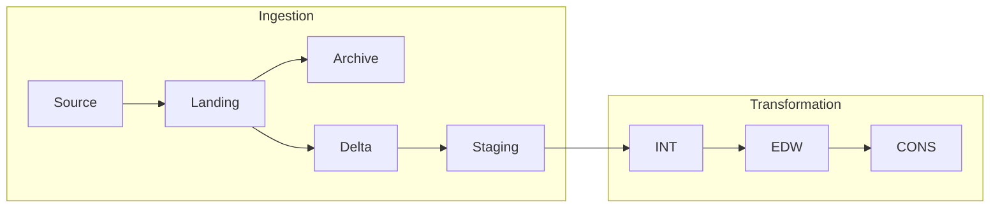

# Data Layers

The journey has an ingestion group and a transformation group. Physical storage, table formats, and serving endpoints vary by platform.

## Layer Responsibilities

| Layer | Role and persistence | First diagnostic question |
| --- | --- | --- |
| Source | Upstream API, database, or file input | Did the extract boundary return complete and permitted data? |
| Landing | Captured source input | Did the expected file or extract arrive for this run? |
| Archive | Retained raw or near-raw input | Which original input explains or can replay the run? |
| Delta | Standardized, table-friendly intake | Did parsing, flattening, types, and sheet selection produce expected columns? |
| Staging | Append-oriented Bronze history | Is the expected source scope present, with lineage and duplicates visible? |
| Integration / INT | Transient model alignment; normally truncate-and-load | Did filtering, deduplication, joins, and derivations produce the intended model? |
| EDW | Durable modeled facts and dimensions | Did append, upsert, or SCD2 preserve required history and keys? |
| Consumption / CONS | Curated reporting views, tables, and downstream surfaces | Does the serving endpoint expose the required output and perspective? |

Archive is a retained branch from captured input, not a transformation every downstream step must pass through.

## Extraction And Writing Are Separate

`deltaOrFull` describes source extraction. `target.write_mode` describes persistence. A Full extract does not imply overwriting Staging; ingestion retains standardized history.

Incremental extraction derives a boundary and translates it into source query or connector filtering. INT can use a watermark while rebuilding its target. Deduplicate to the configured business grain before integration.

Dimensions with missing-member detection need complete current-state input. An ordinary incremental slice can make omitted entities look deleted.

## Durable History

Facts commonly use managed append with retry protection tied to control batch and queue identity. Dimensions generally use SCD2 with business keys, aligned hashes, effective/expiry dates, and current flags. Mapping/reference targets can use approved non-historized behavior.

INT is rebuildable modeled work. EDW is the history authority. [History And Reporting](../concepts/history-and-reporting.md) covers Unknown/inferred members, tombstones, append retries, and reporting grain.

## Reporting Publication

CONS may contain managed tables or catalog views. A Spark view is not automatically visible to a BI endpoint. Automatic SCD2 current-only publication uses a platform publisher; dual-perspective reporting requires a model-specific projection.

Validate object presence, endpoint synchronization, permissions, row grain, and joins. A written EDW target with a failed required CONS publication is not a successful transformation.

## Locate The First Wrong Boundary

Compare source to Landing, captured input to standardized output, Staging to INT, INT to EDW, and EDW to CONS. Collect the same queue identity and source scope throughout. Correct the input or configuration, then recover the affected boundary and dependent work.

Continue with [Ingestion Jobs](../patterns/ingestion-jobs.md), [Transformation Jobs](../patterns/transformation-jobs.md), and [Engine Diagnostics](../troubleshooting/engine-diagnostics.md).
