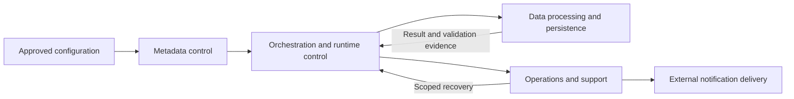
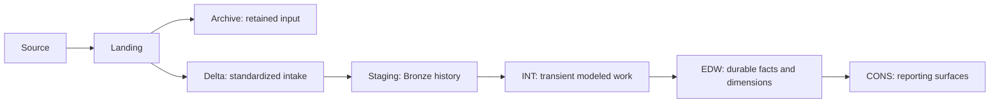

# Framework Architecture

Culina separates the definition of work, runtime coordination, data execution, and operational evidence. The same logical contract can map to different platform services; platform capability and validation status still matter.

## Six Responsibilities

| Responsibility | What it owns | What users inspect |
| --- | --- | --- |
| Configuration authoring and review | Approved job, source, transformation, and service definitions | Reviewed package and environment inputs |
| Metadata control | Deployed definitions, relationships, and governance context | `jobconfig` tables and configuration records |
| Orchestration and runtime control | Batches, queue claims, readiness, retry, and finalization | Queue rows, helper views, platform run identifiers |
| Data processing and persistence | Ingestion, transformation, service work, and reporting outputs | Files, tables, payload and result artifacts |
| Operations and support | Monitoring, validation interpretation, diagnosis, and recovery | Run history, failures, test results, monitoring views |
| External notification delivery | Message formatting, channel routing, and recipients | Notification handoff and delivery response |

## Contract To Evidence

1. A reviewed package describes jobs and their related metadata.
2. Deployment and platform adapters supply environment values and resolve portable references.
3. Orchestration seeds a batch and queue rows, then evaluates dependencies.
4. A claimed queue row becomes a bounded `payload.json` for ingestion, transformation, or service execution.
5. Execution returns `result.json`, metrics, step evidence, and validation outcomes.
6. Orchestration persists official evidence, applies retry policy, and finalizes state.

A payload is a work order. A result artifact is evidence to be interpreted. A successful target write alone does not establish a successful queue outcome.

## Ownership At The Runtime Boundary

| Concern | Owner |
| --- | --- |
| SQL control-plane access, queue claims, readiness, official status | Orchestration workers |
| Approved context and platform settings | Orchestration and deployment adapters |
| Source access, ordered execution, data writes, result artifacts | Workload execution |
| Credential values and provider roots | Environment secret configuration |
| Reporting endpoint exposure and BI permissions | Platform reporting adapter and environment owner |

The data executor receives approved context rather than retrieving or changing SQL control metadata itself. SQL reporting adapters that publish data-plane views are distinct from the SQL control plane.

## Data Journey

`Delta` is a layer name. Delta extraction is an incremental loading choice. Delta Lake is a physical table format. Distinguish these meanings when reading configuration or diagnosing a run.

## Continue

- [Control Plane Schema](control-plane-schema.md): tables, views, and relationships.
- [Orchestration Plane](orchestration-plane.md): hierarchy and queue lifecycle.
- [Data Layers](data-layers.md): persistence and recovery boundaries.
- [History And Reporting](../concepts/history-and-reporting.md): SCD2, late arrivals, and CONS perspectives.
- [Platforms](../platforms/README.md): platform mappings and qualification status.
