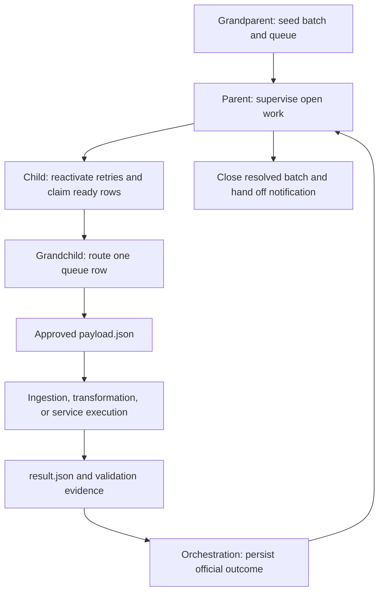
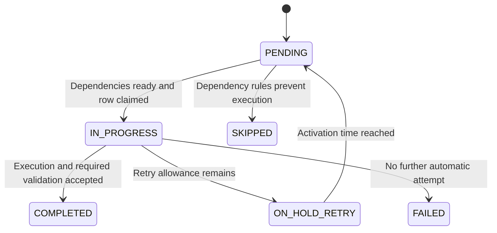

# Orchestration Plane

Culina runs configured work through a batch-and-queue model. A definition in `job` does not execute itself, and a `PENDING` queue row may still be waiting for dependencies.

## Four-Level Hierarchy

| Level | Responsibility | Operating question |
| --- | --- | --- |
| Grandparent | Open a scheduling batch and seed eligible jobs; avoid redundant supervision | Was expected work queued, and is earlier active work still open? |
| Parent | Supervise unresolved work, invoke dispatch, close the batch, and hand off completion notification | Why is the batch still open? |
| Child | Reactivate due retries, select executable rows, claim them as `IN_PROGRESS`, and dispatch | Is the row dependency-ready and claimed? |
| Grandchild | Route one queue row to ingestion, transformation, or service execution and finalization | Which handler received the approved work order? |

The framework considers open active queue state when seeding and evaluating work. Looking at one batch in isolation can hide an earlier unresolved blocker.

## Queue Lifecycle

| State | Meaning | Next step |
| --- | --- | --- |
| `PENDING` | Queued candidate | Dependency checks determine executability |
| `IN_PROGRESS` | Claimed and dispatched | Execution evidence returns to finalization |
| `ON_HOLD_RETRY` | Failed attempt with allowance and an activation time | Child reactivates it when due |
| `COMPLETED` | Official success after applicable execution and validation | Dependents may become ready |
| `FAILED` | Unsuccessful work without another automatic attempt currently allowed | Investigate and select controlled recovery |
| `SKIPPED` | Resolved without successful execution under dependency rules | Inspect upstream chain and skip reason |

These are normal automatic transitions. Follow the [Operating Guide](../operations/operating-guide.md) for manual recovery; changing a status does not restore a failed prerequisite.

## Workload And Evidence Boundaries

Orchestration retrieves deployed metadata and supplies queue identity, environment context, and approved parameters. The workload executes that context and returns a structured result. Official queue, failure, history, and quality records are written through orchestration.

Enabled transformation tests and required reporting publication can prevent success even after data is written. Service side effects may already exist before a failure is returned. Choose retries with both effects and evidence in view.

## Recovery Identity

An automatic retry reuses a queue instance. A managed fact `append` retry replaces that queue's prior contribution rather than multiplying it. Creating a new queue is a new logical append. Neither behavior removes duplicates already present in the source input.

See [Backfill And Recovery](../operations/backfill-and-recovery.md) and [Dependencies And Validation](../guides/dependencies-and-validation.md).

## Notifications

Failure and batch-completion notifications are handoffs to an external delivery service. Delivery owns recipients and channels. Distinguish delivery utility failures from the workload's official outcome; a metadata-governed service job is a separate configured workload.
