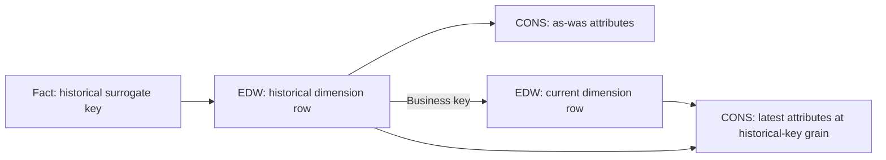

# History And Reporting

EDW retains modeled history. CONS exposes the consumer's reporting perspective without replacing the EDW record.

## Persistence Patterns

| Target | Typical pattern | Requirement |
| --- | --- | --- |
| Fact | Managed `append` | Correct input grain; separate source lineage from control queue identity |
| Dimension | `scd2` | Unique, non-null keys; aligned hashes; complete current-state input for deletion detection |
| Mapping/reference | Approved overwrite, merge, or upsert | Explicit non-historized intent |
| Reporting | Derived view or managed CONS table | Stable join grain and accessible endpoint |

A managed append retry atomically replaces the contribution of the same control `batch_id` and `queue_id`. Physical `_culina_write_id` distinguishes that contribution while preserving source batch values. It is technical evidence, not a business attribute or hash input.

A new queue contributes a new logical append. Use `upsert` for business-key replacement across independent batches. Source duplicates and legacy target duplicates still require validation and reconciliation.

## SCD2 Target Contract

Supply this target fragment inside reviewed transformation parameters with sources and ordered steps.

```json
{
  "db": "edw",
  "table": "Dim_Customer",
  "business_keys": ["Customer_ID"],
  "write_mode": "scd2",
  "scd2": {
    "surrogate_key_column": "Customer_Key",
    "effective_date_column": "Effective_Date",
    "expiry_date_column": "Expiry_Date",
    "current_flag_column": "Is_Current",
    "effective_from_column": "stg_load_date",
    "hash_column": "hash_value",
    "infinite_future_date": "9999-12-31",
    "current_reporting": {
      "enabled": true,
      "namespace": "con",
      "name_template": "vw_{table}_Current",
      "publish_for_bi": true
    }
  }
}
```

Business keys identify entities; surrogate keys identify physical versions. Hashes identify meaningful changes. Effective/expiry dates delimit validity; the current flag selects the active version.

Validate uniqueness and nullability first. Missing-member detection requires complete current-state data; a partial Delta extract can otherwise classify omitted entities as deletions. Tombstones express disappearance while retaining historical evidence.

## Unknown And Late Arrivals

The current SCD2 writer maintains a standard Unknown member with surrogate key `-1`. Eligible dimension joins route null or blank fact lookups to it.

A non-null lookup whose dimension record has not arrived uses an inferred placeholder with a deterministic negative BIGINT key below `-1`. Hydration fills that placeholder when the real row arrives and preserves its key, so facts need no rewrite.

| Technical field | Meaning |
| --- | --- |
| `_mf_member_status` | `UNKNOWN`, `INFERRED`, or `RESOLVED` |
| `_mf_inference_key_hash` | Normalized lookup fingerprint |
| `_mf_inferred_at_utc` | Placeholder creation time |
| `_mf_resolved_at_utc` | Successful hydration time |

These are execution-owned fields, not new transformation parameters. The data-plane registry defaults to `_mf.dimension_member_registry`, inheriting the catalog for a three-part dimension. `CULINA_DIMENSION_REGISTRY_TABLE` may override it.

Inference requires an unambiguous join to one tagged SCD2 dimension, projection of its surrogate key, and all canonical or declared alternate lookup keys. Ambiguous projections and unrelated lookups do not automatically infer members. Collisions or conflicting hydration mappings fail before fact persistence.

## Reporting Perspectives

| Perspective | Rows and attributes | Fact relationship |
| --- | --- | --- |
| As-was | Every historical version with original attributes | Historical fact key to historical dimension key |
| Current value | One row per historical surrogate key with latest attributes for that entity | Existing historical fact key remains valid |
| Current only | Active rows selected by current flag | Business key or current surrogate key |

Joining historical fact keys to a current-only view loses matches for superseded versions. A current-value or dual-perspective projection preserves the historical key while bringing in current attributes.



A model-specific dual-perspective query body might be:

```sql
SELECT
    historical.Customer_Key,
    historical.Customer_ID,
    historical.Customer_Name AS Customer_Name_As_Was,
    current_row.Customer_Name AS Customer_Name_Current
FROM edw.Dim_Customer AS historical
LEFT JOIN edw.Dim_Customer AS current_row
    ON historical.Customer_ID = current_row.Customer_ID
   AND current_row.Is_Current = 1;
```

Confirm columns and namespaces in your environment. A missing current mapping stays null and should be counted by validation.

## Automatic Current-Only Publication

`target.scd2.current_reporting` enables the active-row projection after a successful SCD2 write. Required publication failure fails the transformation, preventing a successful batch from masking a stale surface.

| Platform | BI-facing publication |
| --- | --- |
| Fabric | Managed Delta table in CONS; check SQL analytics endpoint synchronization |
| AWS / Athena | Athena catalog view; validate connector, permissions, and gateway needs |
| Databricks | Unity Catalog view exposed through approved SQL connection |
| Synapse | Injected BI-facing publisher when `publish_for_bi=true` |
| Local | Injected reporting publisher when `publish_for_bi=true`; Spark-only views do not establish BI access |

A Spark-only surface may suit Spark consumers when `publish_for_bi=false`. Dual-perspective shapes remain explicit `deployment_artifacts` with `artifact_type=view` and `phase=after_transformation`, or an equivalent governed serving table.

## Acceptance Checks

For a historical-key projection, compare view and dimension row counts; verify historical key uniqueness/non-nullability and at most one current row per business key. Fact joins must not increase fact row count. Verify attribute families and count missing current mappings.

Continue with [Transformation Jobs](../patterns/transformation-jobs.md), [Dependencies And Validation](../guides/dependencies-and-validation.md), and [Backfill And Recovery](../operations/backfill-and-recovery.md). [Episode 7](../tutorials/README.md#07-how-scd2-builds-trustworthy-history) explains the original SCD2 flow; this reference includes subsequent capabilities.
