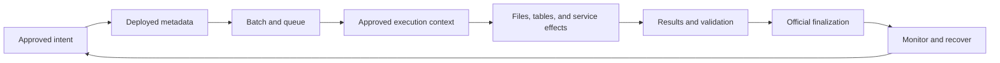

# Framework Overview

Culina describes work in metadata, coordinates it through a queue, executes it using a consistent contract, and records evidence that users can diagnose.

## The Operating Loop

## What Is Defined

Jobs specify workload type and retry policy. Source details describe extraction and standardization. Linked services describe source access. Transformations specify ordered steps and targets. Service configurations describe operational tasks. Dependencies and validation determine readiness and acceptance.

Approved portable packages keep logical settings separate from physical storage roots, secret providers, and environment values. See [Configuration Guide](../configuration/README.md).

## What Actually Runs

Grandparent seeds work, Parent supervises it, Child claims dependency-ready queue rows, and Grandchild routes each workload. Orchestration supplies `payload.json`; workload execution returns `result.json`. Orchestration retains authority over official queue status and SQL evidence.

A queued job may correctly wait. A written table may still fail required validation. A notification error may have a different authority from the workload outcome.

## Where Data Lives

Ingestion captures Source -> Landing -> Archive/Delta -> Staging. Transformation aligns Staging -> INT -> EDW -> CONS. Staging retains standardized history, INT is transient modeled work, EDW is durable modeled history, and CONS exposes reporting outputs.

Current behavior includes managed append retry identity, SCD2 Unknown/inferred members, and automatic current-only reporting publication. [History And Reporting](../concepts/history-and-reporting.md) explains the requirements and limitations.

## First Questions To Ask

| Question | Reference |
| --- | --- |
| What job and inputs are configured? | [Control Plane Schema](../architecture/control-plane-schema.md) |
| Why is this queue row waiting or retrying? | [Orchestration Plane](../architecture/orchestration-plane.md) |
| Which data boundary first became wrong? | [Data Layers](../architecture/data-layers.md) |
| Which platform path is installed? | [Platforms](../platforms/README.md) |
| Which evidence is authoritative? | [Diagnostic Queries](../troubleshooting/diagnostic-queries.md) |
| What recovery changes only affected work? | [Backfill And Recovery](../operations/backfill-and-recovery.md) |

Start with the [Quickstart](quickstart.md), or return to [Start Here](README.md).
