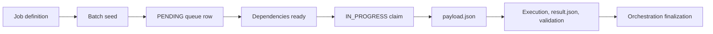

# Quickstart: Trace A Workflow

Trace a configured ingestion and its downstream transformation without starting a live job. This exercise explains the contract-to-evidence path; it does not provision or execute an environment.

## 1. Choose The Right Reference

Open [Current Examples](../../examples/current/README.md) and inspect its package layout, metadata envelope, environment manifest, source records, and transformation parameters. Use [Config Field Reference](../reference/config-field-reference.md) to distinguish export field names from deployed SQL columns.

For a complete original sandbox with known relationships, use [Sandbox Client Metadata](../configuration/sandbox-client-example.md). That fixture contains 24 jobs, 6 linked services, 13 source details, 11 transformations, and 15 dependencies; its original export format is explained in the [Example Catalog](../../examples/README.md).

## 2. Identify The Configured Job

Record its job identifier, `entityName`, `jobType`, activation flag, and retry policy. For an ingestion, follow its `source_detail` relationship to the linked service. For a transformation, follow the controller parameters to sources, target, and ordered steps.

A job definition describes what should happen. A runtime queue row identifies one attemptable work instance.

Use this concrete path from the current package:

| Work | Inspect | Follow |
| --- | --- | --- |
| REST ingestion | [orders-rest job](../../examples/current/contract-template/jobs/orders-rest.json) | [source details](../../examples/current/contract-template/source-details/orders-rest.json) and [linked service](../../examples/current/contract-template/linked-services/orders-api.json) |
| Integration | [orders-int job](../../examples/current/contract-template/jobs/orders-int.json) | [ordered transformation](../../examples/current/contract-template/transformations/orders-int.json) and [upstream dependency](../../examples/current/contract-template/dependencies/orders-int-orders-rest.json) |
| Service | [publish-status job](../../examples/current/contract-template/jobs/publish-status.json) | [HTTP service configuration](../../examples/current/contract-template/service-configs/publish-status.json) and [INT dependency](../../examples/current/contract-template/dependencies/publish-status-orders-int.json) |

The file ingestion job is an independent alternative example, not another dependency of this INT job. All example jobs are inactive and use synthetic identifiers.

## 3. Follow The Input Boundary

Check source path/query, connector settings, `deltaOrFull`, incremental field or parameter mapping, output columns, and staging destination.

For file input, follow the logical `storage://` alias to the environment root. For credentials, follow `secret://` through the configured provider root without putting credential values into the package. Unresolved environment tokens must be handled before deployment.

Full/Delta extraction is separate from target write behavior. A Full source read can still append standardized Staging history.

In this REST example, `sourceDeltaColumn` is `updated_at`, the connector request parameter is `updated_since`, and the initial fallback is `1900-01-01T00:00:00Z`. Verify the real endpoint honors that filter before activation. The standardized output maps source `id` to `order_id` and lands in `Orders_Rest`.

## 4. Follow The Transformation

Check source aliases and watermark/filter scope, then the deduplication grain, joins, computed fields, target business keys, and `write_mode`.

For SCD2, inspect the hash and effective/current fields and confirm input represents complete current state when detecting missing members. For fact append, distinguish retrying one queue from seeding a new queue.

Use [History And Reporting](../concepts/history-and-reporting.md) when the target publishes a CONS surface or joins late-arriving dimension members.

The example INT steps read `stg.Orders_Rest`, filter ingestion history using `stg_load_date`, keep the newest row per `order_id`, and write `int.Orders` with `truncate_insert`. This is transient integration state, not a persistent fact append or SCD2 dimension.

## 5. Trace Dependencies And Runtime

A `PENDING` row is only a candidate. Its upstream evidence and readiness rules control dispatch. Inspect the current [Control Plane Schema](../architecture/control-plane-schema.md) and [Dependencies And Validation](../guides/dependencies-and-validation.md).

## 6. Diagnose One Hypothetical Failure

Suppose the target exists but the job failed. Find the same queue identity in [Diagnostic Queries](../troubleshooting/diagnostic-queries.md), then inspect step, failure, validation, and publication evidence. A write can finish before a required test or reporting publication fails.

For waiting or skipped work, trace the earliest unresolved upstream row. For wrong data with official success, compare the last correct layer to the first incorrect layer.

Choose a scoped action with [Backfill And Recovery](../operations/backfill-and-recovery.md), rather than assuming a new full append is equivalent to an automatic retry.

## Continue

Use the [Configuration Guide](../configuration/README.md) to add work, [Operations Guide](../operations/README.md) to inspect a real environment, or [Workbook Exercises](../../workbook/README.md) to practice locally.
