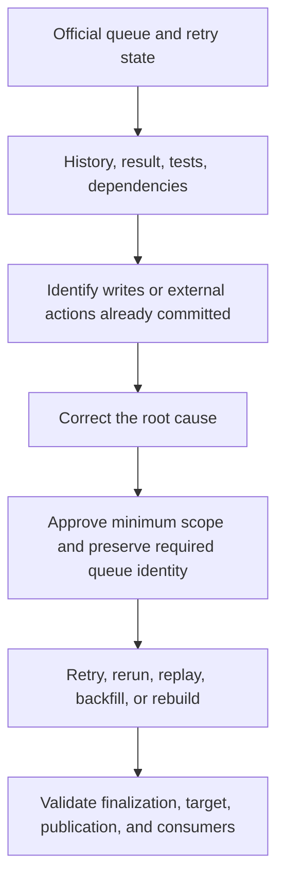

# Diagnostic Queries

These read-only SQL Server examples use current `jobconfig` tables and `rpt` views. They apply to the SQL-hosted control plane, not Spark/Athena target SQL. Use least-privilege read access; do not export raw comments, test details, or configuration into a public issue without checking for sensitive values.

Supply the affected identifiers as bound UUID parameters in your query tool. In SSMS, run this setup and the desired query together, replacing only the NULLs locally with approved values:

```sql
DECLARE @queue_id uniqueidentifier = NULL;
DECLARE @batch_id uniqueidentifier = NULL;
DECLARE @job_id uniqueidentifier = NULL;
DECLARE @deployment_id uniqueidentifier = NULL;
```

NULL deliberately matches nothing. Academy numeric sandbox IDs are historical learning identifiers, not these SQL UUID keys. All timestamps below are UTC. These queries diagnose state; they do not reset, claim, finalize, or mark anything notified.

## 1. Find Current State For One Workflow

```sql
SELECT TOP (50)
    q.queue_id, q.batch_id, q.job_id, j.entity_name, j.job_type,
    q.status, q.current_retry_count, q.retry_datetime,
    j.max_retry_count, j.retry_delay_backoff,
    q.queue_inserted_datetime, q.job_start_datetime, q.job_end_datetime,
    b.batch_start_time, b.batch_end_time, b.is_batch_completed
FROM jobconfig.job_queue AS q
JOIN jobconfig.jobs AS j ON j.job_id = q.job_id
JOIN jobconfig.batch_time AS b ON b.batch_id = q.batch_id
WHERE q.job_id = @job_id
ORDER BY q.queue_inserted_datetime DESC, q.queue_id;
```

`current_retry_count` counts scheduled retries, not attempts. `retry_delay_backoff` is seconds. A queue on `ON_HOLD_RETRY` is promoted when its `retry_datetime` becomes due; `FAILED` is terminal for the current run and still prevents batch closure.

For one batch, compare the exact closure-blocking states:

```sql
SELECT b.batch_id, b.batch_start_time, b.batch_end_time, b.is_batch_completed,
    COUNT(q.queue_id) AS queued_jobs,
    SUM(CASE WHEN q.status IN
        (N'PENDING', N'IN_PROGRESS', N'FAILED', N'ON_HOLD_RETRY')
        THEN 1 ELSE 0 END) AS closure_blocking_jobs
FROM jobconfig.batch_time AS b
LEFT JOIN jobconfig.job_queue AS q ON q.batch_id = b.batch_id
WHERE b.batch_id = @batch_id
GROUP BY b.batch_id, b.batch_start_time, b.batch_end_time, b.is_batch_completed;
```

`SKIPPED` does not block closure. An empty batch is not automatically closed by the queue-grouped closure procedure, so zero blockers alone is not a closure guarantee.

## 2. Read Failure Evidence

```sql
SELECT TOP (50)
    f.failure_log_id, f.queue_id, q.batch_id, q.job_id, j.entity_name,
    q.status, f.failure_message, f.failure_datetime,
    f.is_notified_sent, f.is_actioned, f.actioned_by, f.actioned_datetime
FROM jobconfig.job_failure_log AS f
JOIN jobconfig.job_queue AS q ON q.queue_id = f.queue_id
JOIN jobconfig.jobs AS j ON j.job_id = q.job_id
WHERE f.queue_id = @queue_id
ORDER BY f.failure_datetime DESC, f.failure_log_id;
```

There is no `job_id`, `error_stage`, or `error_category` column on the failure table. Join through queue identity. Retry-held failures may have no terminal failure-log row; inspect history next. `is_notified_sent` records handoff marking, not recipient receipt; `is_actioned` is follow-up evidence, not queue completion.

## 3. Compare Run History Steps

```sql
SELECT TOP (200)
    h.job_run_log_id, h.queue_id, h.zone,
    h.job_run_status, h.job_log_datetime, h.comments
FROM jobconfig.job_runhistory AS h
WHERE h.queue_id = @queue_id
ORDER BY h.job_log_datetime, h.job_run_log_id;
```

History is event-grain: it has no `step_name`, `started_at`, `completed_at`, or `row_count` columns. The finalizer may append `Diagnostics JSON:` to comments with `workload_run_id`, `step_results`, metrics, target, watermark, and tests. Inspect the authoritative runtime result for the full attempt; timestamps or comment text alone are not a complete attempt ledger.

Queue-grain reporting exposes latest recorded event and provisional duration:

```sql
SELECT QueueId, BatchId, JobId, QueueStatus, CurrentRetryCount,
    StartUtc, EndUtc, RetryUtc, DurationSeconds, IsProvisionalDuration,
    QuerySnapshotUtc, LatestEventStatus, LatestEventZone, LatestEventUtc
FROM rpt.vw_pbi_job_run
WHERE QueueId = @queue_id;
```

Latest event `FAILED` can coexist with queue `ON_HOLD_RETRY`. Duration is not cumulative retry time; a started row without an end uses query snapshot time.

## 4. Trace Waiting Work To Upstream Blockers

First inspect the same authority used by claiming:

```sql
SELECT queue_id, job_id, batch_id, entity_name, job_type,
    job_queue_status, current_retry_count, max_retry_count,
    total_dependencies, completed_dependencies,
    failed_dependencies, onhold_dependencies, can_execute
FROM jobconfig.vw_job_dependency_check
WHERE queue_id = @queue_id;
```

The view covers open batches and counts ancestor queue rows across open batches. It does not enforce a same-batch-only prerequisite check or require a queue row for every configured dependency; zero observed dependencies can yield `can_execute = 1`. Compare the hierarchy when expected work is missing.

```sql
SELECT TOP (200)
    h.dependency_level, h.dependent_job_id AS upstream_job_id,
    j.entity_name AS upstream_entity_name,
    q.queue_id AS upstream_queue_id, q.batch_id AS upstream_batch_id,
    q.status AS upstream_status, q.retry_datetime
FROM jobconfig.vw_job_dependency_hierarchy AS h
JOIN jobconfig.jobs AS j ON j.job_id = h.dependent_job_id
LEFT JOIN (
    SELECT oq.queue_id, oq.job_id, oq.batch_id, oq.status, oq.retry_datetime
    FROM jobconfig.job_queue AS oq
    JOIN jobconfig.batch_time AS ob ON ob.batch_id = oq.batch_id
    WHERE ob.is_batch_completed = 0
) AS q ON q.job_id = h.dependent_job_id
WHERE h.root_job_id = @job_id
ORDER BY h.dependency_level, j.entity_name, q.batch_id, q.queue_id;
```

`root_job_id` is the job whose prerequisites are being inspected; `dependent_job_id` is its upstream ancestor. A NULL queue means no matching open-batch row, not a completed prerequisite. Correlate trigger/planning scope before treating absence as a blocker or resetting descendants.

## 5. Map Ingestion Failure To Source Metadata

```sql
SELECT j.job_id, j.entity_name, j.is_active,
    sd.source_detail_id, sd.source_entity_name,
    sd.source_linked_service_config_id,
    ls.source_name, ls.source_type,
    sd.delta_or_full, sd.source_delta_column, sd.fallback_watermark,
    sd.landing_file_extension, sd.delta_file_extension, sd.staging_table_name,
    ISJSON(sd.source_select_query) AS source_query_is_json
FROM jobconfig.jobs AS j
JOIN jobconfig.source_detail AS sd ON sd.job_id = j.job_id
LEFT JOIN jobconfig.source_linked_service_config AS ls
    ON ls.source_linked_service_config_id = sd.source_linked_service_config_id
WHERE j.job_id = @job_id;
```

Review `source_select_query` and linked-service JSON locally with the effective runtime context; full query/config bodies are intentionally not selected for routine evidence export. Check path/query, request parameters, delta/flatten rules, and actual watermark. `fallback_watermark` is not proof of the watermark used on this run.

For portable files, inspect `storage_alias` and `storage_setting` diagnostics. Resolve missing environment mappings before changing portable metadata; see [Engine Diagnostics](engine-diagnostics.md).

## 6. Map Transformation Failure To Step Metadata

```sql
SELECT tc.transformation_controller_id, tc.job_id,
    tc.transformation_name, tc.transformation_type, tc.is_active,
    tc.initial_load, tc.test_data_integrity, tc.test_duplicate_bks, tc.test_null_bks,
    JSON_QUERY(tc.parameters, '$.sources') AS configured_sources,
    JSON_QUERY(tc.parameters, '$.target') AS configured_target,
    JSON_QUERY(tc.parameters, '$.transformation.steps') AS configured_steps
FROM jobconfig.transformation_controller AS tc
WHERE tc.job_id = @job_id;
```

Inspect only the active controller used by the runtime. Compare staging filters, business-key grain, source aliases, write mode, and failed step. Do not substitute old sandbox `transformation` or `job` table names.

Managed fact append replaces the same control batch/queue's `_culina_write_id` contribution atomically on retry. A new queue appends again; source `Batch_ID` is retained and is not a queue identity. Use test details and runtime counts to distinguish one contribution from all rows sharing a source batch. Existing duplicates still require reconciliation; same-queue retry protection does not correct duplicate input.

For SCD2, validate current-row uniqueness and residual new/changed rows rather than demanding incoming count equal new-history count. Unknown `-1` and inferred keys below `-1` are valid framework members; successful hydration preserves inferred keys.

## 7. Decide Recovery Scope



Use [Backfill And Recovery](../operations/backfill-and-recovery.md); no query here authorizes a queue reset or target deletion.

## 8. Inspect Required Validation

```sql
SELECT TOP (100)
    UnitTestResultId, QueueId, BatchId, JobId,
    TransformationName, TestName, TestType, TestStatus, TestResult,
    TestDetails, WorkloadRunId, ExecutedUtc, IsLatestPerTest
FROM rpt.vw_pbi_unit_test_result
WHERE QueueId = @queue_id
ORDER BY ExecutedUtc DESC, UnitTestResultId;
```

Compare workload identity with the authoritative result. A latest recorded pass can predate a later logging failure. Required failed tests block completion even when the target write committed. For managed append, integrity checks isolate the control queue contribution, not all rows with source `Batch_ID`; missing control identity on a tagged target is a failure. For legacy untagged append/upsert/merge, compatible incoming-batch filtering remains relevant; `truncate_insert` checks the replacement target count.

## 9. Inspect Service Configuration Cardinality

```sql
SELECT j.job_id, j.entity_name, j.job_type, j.is_active,
    COUNT(sc.service_config_id) AS active_service_config_count
FROM jobconfig.jobs AS j
LEFT JOIN jobconfig.service_config AS sc
    ON sc.job_id = j.job_id AND sc.isactive = 1
WHERE j.job_id = @job_id
GROUP BY j.job_id, j.entity_name, j.job_type, j.is_active;

SELECT sc.service_config_id, sc.job_id, sc.service_type, sc.isactive
FROM jobconfig.service_config AS sc
WHERE sc.job_id = @job_id;
```

The execution-context procedure requires `Service`, an active job, exactly one active configuration, and JSON-object runtime options. It raises errors for zero/multiple active rows. Inspect handler/mode and sanitized runtime steps locally; do not export service-config or linked-service bodies containing access details.

## 10. Inspect Notification Handoff Evidence

```sql
SELECT TOP (50)
    f.failure_log_id, f.queue_id, q.status,
    f.failure_datetime, f.is_notified_sent
FROM jobconfig.job_failure_log AS f
JOIN jobconfig.job_queue AS q ON q.queue_id = f.queue_id
WHERE q.batch_id = @batch_id
  AND f.is_notified_sent = 0
  AND q.status = N'FAILED'
ORDER BY f.failure_datetime, f.failure_log_id;

SELECT b.batch_id, b.is_batch_completed, b.batch_end_time,
    n.notification_type, n.notification_status,
    n.notification_dispatch_id, n.notification_datetime
FROM jobconfig.batch_time AS b
LEFT JOIN jobconfig.batch_notification_log AS n
    ON n.batch_id = b.batch_id
   AND n.notification_type = N'BATCH_COMPLETION'
WHERE b.batch_id = @batch_id;
```

First query matches terminal failure dispatch eligibility within the selected batch. Second distinguishes closure from persisted completion handoff. `SENT` is the only stored notification status; failures are not rows with a `FAILED` notification status. Missing marking after accepted POST can cause duplicate handoff. Check utility activity and downstream service evidence before redispatch.

## 11. Inspect Contract Validation And Application

```sql
SELECT deployment_id, contract_name, deploy_mode, deployment_status,
    started_at_utc, ended_at_utc, total_object_count, changed_object_count,
    applied_object_count, skipped_object_count,
    validation_error_count, validation_warning_count, detail_message
FROM jobconfig.contract_deployment
WHERE deployment_id = @deployment_id;

SELECT TOP (100)
    validation_result_id, deployment_id, chunk_id, object_type, object_key,
    contract_path, severity, rule_code, message, created_datetime
FROM jobconfig.contract_validation_result
WHERE deployment_id = @deployment_id
ORDER BY created_datetime, validation_result_id;
```

`VALIDATED`/`PREVIEWED` do not mean applied; `READY_TO_APPLY` is also not completion. Inspect `VALIDATION_FAILED`/`FAILED` and rule evidence before recovery. Unresolved environment tokens or invalid relationships must be fixed in the resolved contract/bindings; do not use force apply to bypass validation. Share paths/messages only after checking sensitive content.
